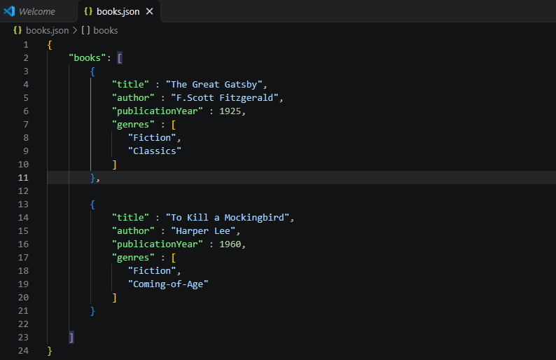
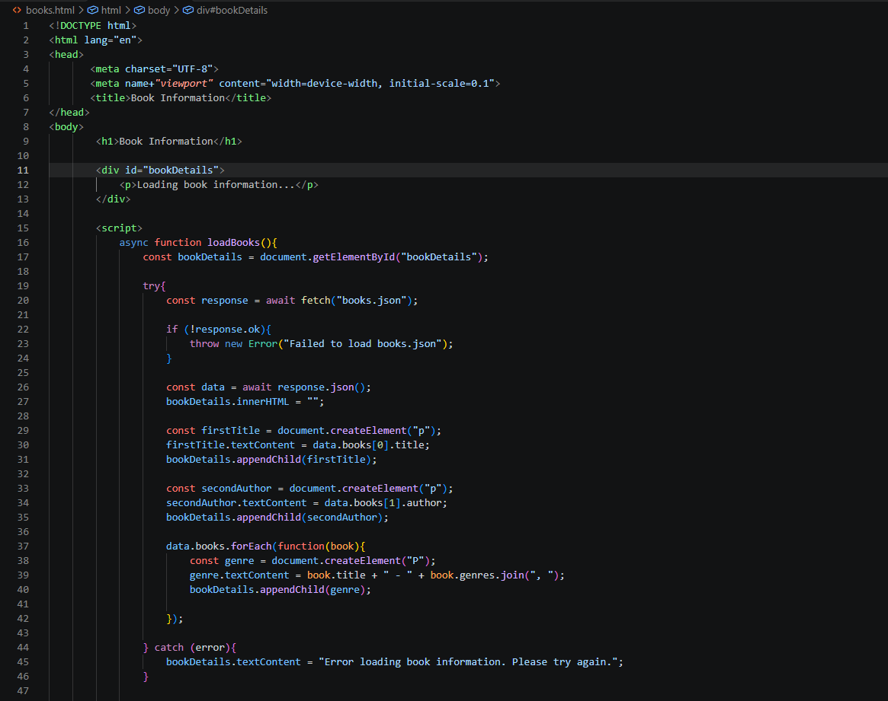
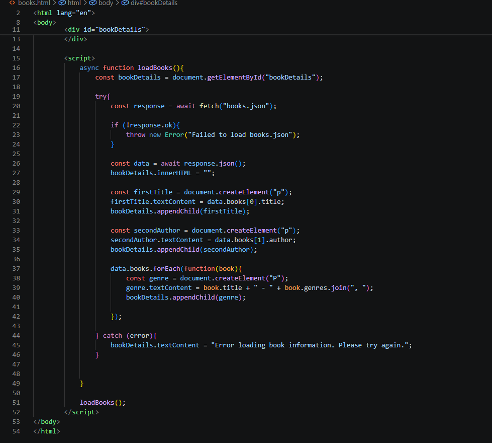
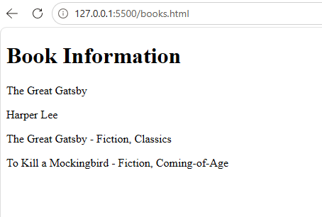
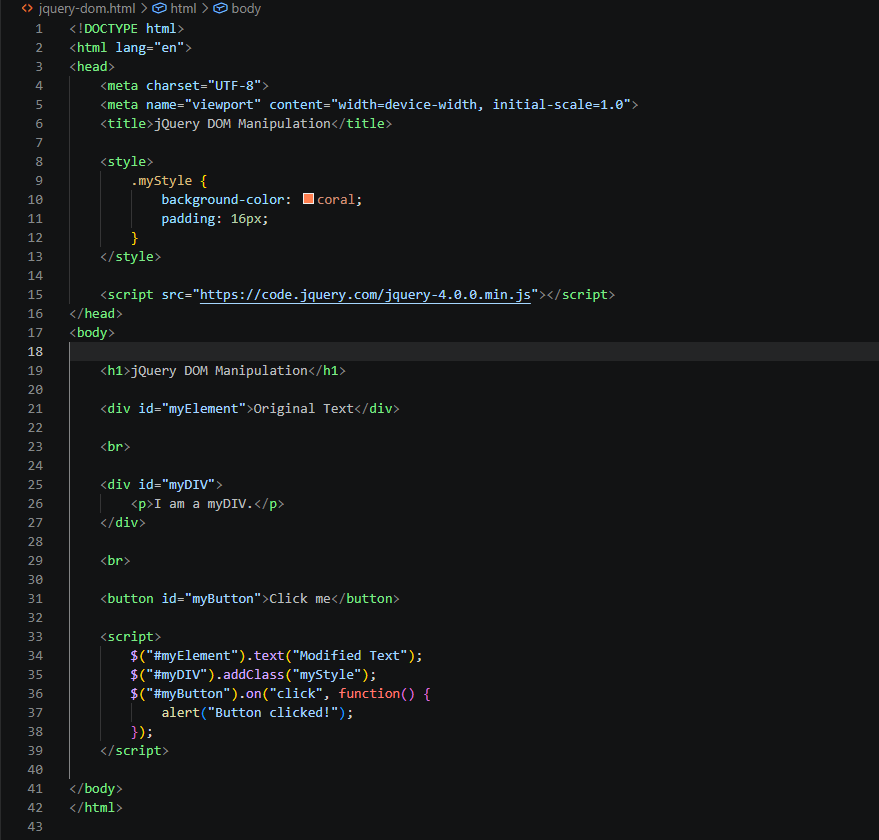
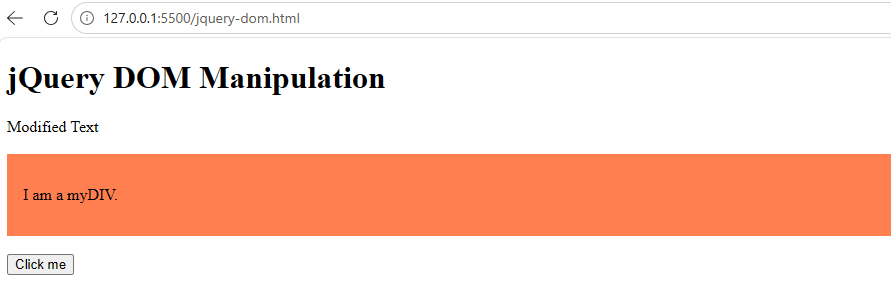

# Lab 4b: Client-Side Scripting (JSON and jQuery)

- **Name:** NURFATIN ELYA BINTI MUSTAFA
- **Lab:** Lab 4b

## Project Description
This lab demonstrates how to create and structure JSON data, retrieve and display JSON data using JavaScript fetch(), and perform DOM manipulation using jQuery.

## Brief Instructions

Q1. Create and Structure JSON Data
- Create a JSON file named books.json containing two books records where each record stored information about the title, author, publication year and genres.

Q2. Retrieve and Display JSON Data
- Create books.html and use JavaScript fetch() API to retrieve data about the books information and display the following items within webpage.

Q3. Compare Native JavaScript and jQuery 
- Use jQuery to modifying text, adding a CSS class and handling button clicks using .text(), .addClass() and .on().

## Screenshots

### Question 1: JSON Data

### Question 2: Retrieve and Display JSON Data

### Question 3: jQuery DOM Manipulation

